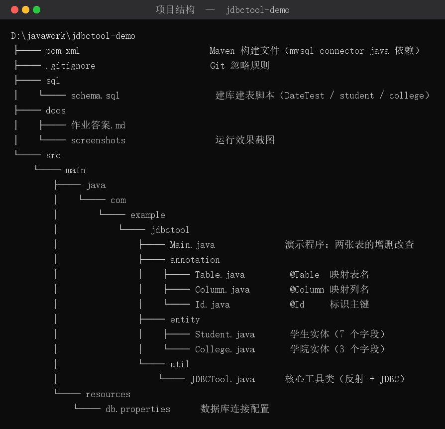
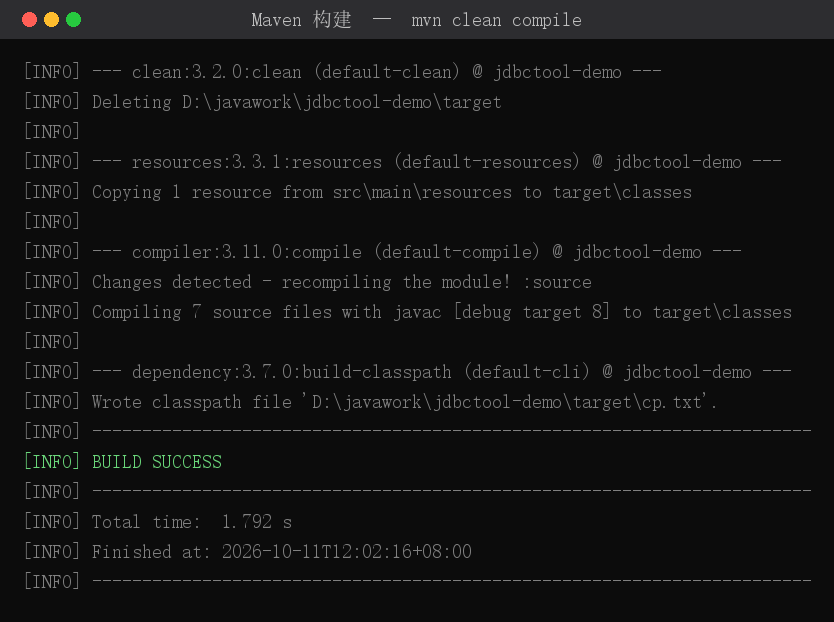
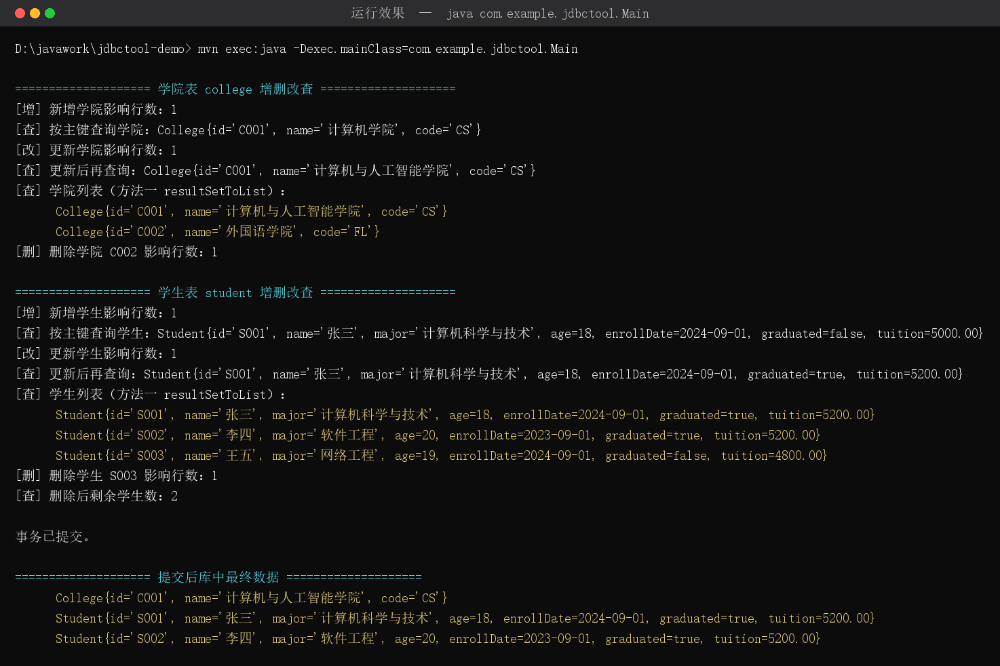
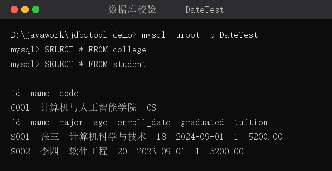
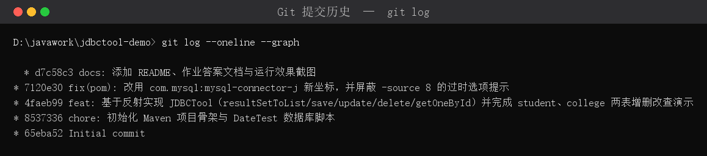

# 作业答案 —— 基于 JDBC + 反射的 ORM 工具类 JDBCTool

**项目名**：jdbctool-demo　|　**Git 仓库地址**：<https://github.com/Kanade-12/java.git>

---

## 一、ORM 基本原理（对应目标 1）

ORM（Object Relational Mapping，对象关系映射）要解决的是**「Java 对象」与「数据库表记录」之间的阻抗失配**问题：

| 面向对象世界 | 关系型数据库世界 |
| --- | --- |
| 类 Class | 表 Table |
| 对象 Object | 一行记录 Row |
| 属性 Field | 列 Column |

映射方向有两个：

- **正向（对象 → 表）**：读取对象的属性值，拼成 `INSERT` / `UPDATE` / `DELETE` 语句并执行，即 `save` / `update` / `delete`。
- **反向（表 → 对象）**：遍历 `ResultSet` 的每一行，按列名找到对应的属性并反射赋值，即 `resultSetToList` / `getOneById`。

本项目用**自定义注解**描述映射关系：

```java
@Table("student")                       // 类  -> 表
public class Student {
    @Id  @Column("id")                  // 主键 -> 列 id
    private String id;

    @Column("enroll_date")              // 属性 enrollDate -> 列 enroll_date（解决命名风格不一致）
    private Date enrollDate;
    ...
}
```

映射关系一旦被注解描述出来，CRUD 就可以写成完全通用的代码 —— 这正是 MyBatis / Hibernate 等框架的雏形。

---

## 二、反射机制的应用（对应目标 2）

`JDBCTool` 中反射用在三个地方：

**1）根据 Class 创建对象（`resultSetToList`）**

```java
T obj = clazz.getDeclaredConstructor().newInstance();
```

**2）给私有属性赋值 / 取值**

```java
field.setAccessible(true);   // 突破 private 访问限制
field.set(obj, converted);   // 反向：表 -> 对象
Object v = field.get(obj);   // 正向：对象 -> SQL 参数
```

**3）读取注解，得到表名与列名**

```java
Table t  = clazz.getAnnotation(Table.class);
Column c = field.getAnnotation(Column.class);
```

此外还用到 `getDeclaredFields()` 遍历字段（并递归到父类）、`Modifier.isStatic/isTransient` 过滤掉不该映射的字段。

---

## 三、JDBC 增删改查（对应目标 3）

统一的 JDBC 操作套路：

```java
String sql = "INSERT INTO student (id,name,...) VALUES (?,?,...)";
try (PreparedStatement ps = connection.prepareStatement(sql)) {  // try-with-resources 自动关流
    ps.setObject(1, id);            // 占位符参数绑定，防 SQL 注入
    int rows = ps.executeUpdate();  // 增删改：返回影响行数
    ...
}
```

查询则多一步拿结果集：

```java
try (PreparedStatement ps = connection.prepareStatement(sql);
     ResultSet rs = ps.executeQuery()) {
    return JDBCTool.resultSetToList(rs, clazz);   // 结果集 -> 对象列表
}
```

关键点：**全程使用 `PreparedStatement` + `?` 占位符**，而不是字符串拼接，从根本上杜绝 SQL 注入；所有资源用 try-with-resources 释放；事务由调用方通过 `setAutoCommit(false)` + `commit()` 控制。

---

## 四、JDBCTool 工具类（对应目标 4）

文件：[`src/main/java/com/example/jdbctool/util/JDBCTool.java`](../src/main/java/com/example/jdbctool/util/JDBCTool.java)

### 4.1 五个核心方法

| # | 方法签名 | 作用 |
| --- | --- | --- |
| 1 | `static <T> List<T> resultSetToList(ResultSet rs, Class<T> clazz)` | 结果集 → 对象列表 |
| 2 | `static <T> int save(T obj, Connection connection)` | 新增，返回影响行数 |
| 3 | `static <T> int update(T obj, Connection connection)` | 按主键更新，返回影响行数 |
| 4 | `static <T> int delete(T obj, Connection connection)` | 按主键删除，返回影响行数 |
| 5 | `static <T> T getOneById(String id, Class<T> clazz, Connection connection)` | 按主键查询单个对象 |

### 4.2 方法 1 —— resultSetToList（结果集映射）

```java
public static <T> List<T> resultSetToList(ResultSet rs, Class<T> clazz) throws Exception {
    List<T> list = new ArrayList<>();
    Map<String, Field> columnFieldMap = getColumnFieldMap(clazz);   // 列名 -> 属性

    ResultSetMetaData meta = rs.getMetaData();
    int columnCount = meta.getColumnCount();

    while (rs.next()) {
        T obj = clazz.getDeclaredConstructor().newInstance();       // 反射创建对象

        for (int i = 1; i <= columnCount; i++) {
            String columnLabel = meta.getColumnLabel(i);             // 取得列名
            Field field = columnFieldMap.get(columnLabel.toLowerCase(Locale.ROOT));
            if (field != null) {
                setFieldValue(obj, field, rs.getObject(i));          // 反射赋值 + 类型转换
            }
        }
        list.add(obj);
    }
    return list;
}
```

要点：
- 用 `ResultSetMetaData` 拿到**结果集的真实列名**，而不是写死字段顺序，因此 `SELECT id,name` 和 `SELECT *` 都能正确映射；
- 列名 → 属性名的查找表**同时登记了列名和属性名**（都转小写），所以 `enroll_date` 能匹配 `enrollDate`；
- `setFieldValue` → `convertValue` 负责类型转换，覆盖 `Integer / Long / Double / Boolean / BigDecimal / java.sql.Date / LocalDate / LocalDateTime` 等，并对 `null` 与基本类型做了保护。

### 4.3 方法 2 —— save（新增）

```java
public static <T> int save(T obj, Connection connection) throws Exception {
    Class<?> clazz = obj.getClass();
    String tableName = getTableName(clazz);
    List<Field> fields = getMappedFields(clazz);

    StringBuilder columns = new StringBuilder();
    StringBuilder placeholders = new StringBuilder();
    List<Object> params = new ArrayList<>();

    for (Field field : fields) {
        field.setAccessible(true);
        columns.append(getColumnName(field)).append(",");
        placeholders.append("?,");
        params.add(field.get(obj));            // 反射取值
    }
    columns.setLength(columns.length() - 1);       // 去掉末尾逗号
    placeholders.setLength(placeholders.length() - 1);

    String sql = "INSERT INTO " + tableName + " (" + columns + ") VALUES (" + placeholders + ")";
    try (PreparedStatement ps = connection.prepareStatement(sql)) {
        setParameters(ps, params);
        return ps.executeUpdate();
    }
}
```

### 4.4 方法 3 —— update（按主键更新）

先用 `getIdField(clazz)` 找到 `@Id` 标注（或名为 `id`）的字段，拼 SQL 时**跳过主键列**，主键只用于 `WHERE` 条件：

```java
for (Field field : fields) {
    if (field.getName().equals(idField.getName())) continue;   // 主键不参与 SET
    setSql.append(getColumnName(field)).append("=?,");
    params.add(field.get(obj));
}
String sql = "UPDATE " + tableName + " SET " + setSql
           + " WHERE " + getColumnName(idField) + "=?";
params.add(idValue);                       // WHERE 的参数放最后
```

若主键为 `null` 直接抛 `IllegalArgumentException`，避免误更新全表。

### 4.5 方法 4 —— delete（按主键删除）

```java
String sql = "DELETE FROM " + tableName + " WHERE " + getColumnName(idField) + "=?";
try (PreparedStatement ps = connection.prepareStatement(sql)) {
    ps.setObject(1, idValue);
    return ps.executeUpdate();
}
```

### 4.6 方法 5 —— getOneById（按主键查单个）

复用方法 1，把结果列表的第一条返回，没有则返回 `null`：

```java
try (PreparedStatement ps = connection.prepareStatement(sql)) {
    ps.setObject(1, id);
    try (ResultSet rs = ps.executeQuery()) {
        List<T> list = resultSetToList(rs, clazz);
        return list.isEmpty() ? null : list.get(0);
    }
}
```

### 4.7 辅助方法一览（统一访问的支撑）

| 方法 | 作用 |
| --- | --- |
| `getTableName(Class)` | 读 `@Table` 得到表名，缺失时抛异常提示 |
| `getColumnName(Field)` | 读 `@Column` 得到列名，没有注解则用属性名 |
| `getIdField(Class)` | 找 `@Id` 字段；退化为找名为 `id` 的字段 |
| `getMappedFields(Class)` | 收集本类及父类的非 static / transient / synthetic 字段 |
| `getColumnFieldMap(Class)` | 构建「列名 → Field」查找表，供结果集映射使用 |
| `setParameters(ps, params)` | 统一给 `PreparedStatement` 绑定参数 |
| `setFieldValue(obj, field, value)` | 反射赋值，含 `null` 与基本类型保护 |
| `convertValue(value, type)` | JDBC 类型 → Java 属性类型的转换中枢 |

---

## 五、数据库 DateTest 与两张表（对应目标 5）

建库脚本：[`sql/schema.sql`](../sql/schema.sql)

```sql
CREATE DATABASE IF NOT EXISTS DateTest
    DEFAULT CHARACTER SET utf8mb4 DEFAULT COLLATE utf8mb4_general_ci;
USE DateTest;

CREATE TABLE college (
    id   VARCHAR(20)  NOT NULL COMMENT '学院编号（主键）',
    name VARCHAR(100) NOT NULL COMMENT '学院名称',
    code VARCHAR(50)  NOT NULL COMMENT '学院代码',
    PRIMARY KEY (id)
) ENGINE = InnoDB DEFAULT CHARSET = utf8mb4 COMMENT = '学院表';

CREATE TABLE student (
    id          VARCHAR(20)   NOT NULL COMMENT '学号（主键）',
    name        VARCHAR(100)  NOT NULL COMMENT '姓名',
    major       VARCHAR(100)  DEFAULT NULL COMMENT '专业',
    age         INT           DEFAULT NULL COMMENT '年龄',
    enroll_date DATE          DEFAULT NULL COMMENT '入学时间',
    graduated   TINYINT(1)    DEFAULT 0    COMMENT '是否毕业 0-未毕业 1-已毕业',
    tuition     DECIMAL(10,2) DEFAULT NULL COMMENT '学费',
    PRIMARY KEY (id)
) ENGINE = InnoDB DEFAULT CHARSET = utf8mb4 COMMENT = '学生表';
```

对应实体类：[`Student.java`](../src/main/java/com/example/jdbctool/entity/Student.java)、[`College.java`](../src/main/java/com/example/jdbctool/entity/College.java)

---

## 六、两张表的增删改查演示（对应目标 6）

演示程序：[`Main.java`](../src/main/java/com/example/jdbctool/Main.java)

| 操作 | 学院表调用 | 学生表调用 |
| --- | --- | --- |
| 增 | `JDBCTool.save(new College("C001","计算机学院","CS"), conn)` | `JDBCTool.save(student, conn)` |
| 查（单个） | `JDBCTool.getOneById("C001", College.class, conn)` | `JDBCTool.getOneById("S001", Student.class, conn)` |
| 查（列表） | `JDBCTool.resultSetToList(rs, College.class)` | `JDBCTool.resultSetToList(rs, Student.class)` |
| 改 | `JDBCTool.update(collegeDb, conn)` | `JDBCTool.update(studentDb, conn)` |
| 删 | `JDBCTool.delete(delCollege, conn)` | `JDBCTool.delete(delStudent, conn)` |

---

## 七、运行效果抓图（对应目标 9）

### 7.1 项目结构



### 7.2 Maven 构建通过



### 7.3 程序运行效果（两张表的增删改查）



程序完整控制台输出：

```text
D:\javawork\jdbctool-demo> mvn exec:java -Dexec.mainClass=com.example.jdbctool.Main

==================== 学院表 college 增删改查 ====================
[增] 新增学院影响行数：1
[查] 按主键查询学院：College{id='C001', name='计算机学院', code='CS'}
[改] 更新学院影响行数：1
[查] 更新后再查询：College{id='C001', name='计算机与人工智能学院', code='CS'}
[查] 学院列表（方法一 resultSetToList）：
      College{id='C001', name='计算机与人工智能学院', code='CS'}
      College{id='C002', name='外国语学院', code='FL'}
[删] 删除学院 C002 影响行数：1

==================== 学生表 student 增删改查 ====================
[增] 新增学生影响行数：1
[查] 按主键查询学生：Student{id='S001', name='张三', major='计算机科学与技术', age=18, enrollDate=2024-09-01, graduated=false, tuition=5000.00}
[改] 更新学生影响行数：1
[查] 更新后再查询：Student{id='S001', name='张三', major='计算机科学与技术', age=18, enrollDate=2024-09-01, graduated=true, tuition=5200.00}
[查] 学生列表（方法一 resultSetToList）：
      Student{id='S001', name='张三', major='计算机科学与技术', age=18, enrollDate=2024-09-01, graduated=true, tuition=5200.00}
      Student{id='S002', name='李四', major='软件工程', age=20, enrollDate=2023-09-01, graduated=true, tuition=5200.00}
      Student{id='S003', name='王五', major='网络工程', age=19, enrollDate=2024-09-01, graduated=false, tuition=4800.00}
[删] 删除学生 S003 影响行数：1
[查] 删除后剩余学生数：2

事务已提交。

==================== 提交后库中最终数据 ====================
      College{id='C001', name='计算机与人工智能学院', code='CS'}
      Student{id='S001', name='张三', major='计算机科学与技术', age=18, enrollDate=2024-09-01, graduated=true, tuition=5200.00}
      Student{id='S002', name='李四', major='软件工程', age=20, enrollDate=2023-09-01, graduated=true, tuition=5200.00}
```

### 7.4 用 MySQL 客户端直接核对库中数据



证明程序对数据库的操作**真实生效**：`C001` 的名称已被 `UPDATE` 改成「计算机与人工智能学院」、`C002` 已被 `DELETE`、`S001` 的 `tuition` 已从 `5000.00` 变为 `5200.00`、`graduated` 已从 `0` 变为 `1`、`S003` 已被删除。

---

## 八、Maven 构建（对应目标 7）

`pom.xml` 关键配置：

```xml
<dependency>
    <groupId>com.mysql</groupId>          <!-- MySQL 8 官方新坐标 -->
    <artifactId>mysql-connector-j</artifactId>
    <version>8.0.33</version>
</dependency>
```

构建与运行：

```bash
mvn clean compile
mvn exec:java -Dexec.mainClass=com.example.jdbctool.Main
```

---

## 九、Git 版本管理（对应目标 8）

在项目根目录 `D:\javawork\jdbctool-demo` 初始化仓库并分层提交：

```bash
git init -b main
git add .gitignore pom.xml src/main/resources/db.properties sql/schema.sql
git commit -m "chore: 初始化 Maven 项目骨架与 DateTest 数据库脚本"

git add src/
git commit -m "feat: 基于反射实现 JDBCTool（resultSetToList/save/update/delete/getOneById）并完成 student、college 两表增删改查演示"

git add pom.xml
git commit -m "fix(pom): 改用 com.mysql:mysql-connector-j 新坐标，并屏蔽 -source 8 的过时选项提示"

git add README.md docs
git commit -m "docs: 添加 README、作业答案文档与运行效果截图"

git remote add origin https://github.com/Kanade-12/java.git
git push -u origin main
```

`git log` 呈现的版本历史（共 5 个提交，`65eba52` 是远程仓库原有的 Initial commit）：



```text
* d7c58c3 docs: 添加 README、作业答案文档与运行效果截图
* 7120e30 fix(pom): 改用 com.mysql:mysql-connector-j 新坐标，并屏蔽 -source 8 的过时选项提示
* 4faeb99 feat: 基于反射实现 JDBCTool（resultSetToList/save/update/delete/getOneById）并完成 student、college 两表增删改查演示
* 8537336 chore: 初始化 Maven 项目骨架与 DateTest 数据库脚本
* 65eba52 Initial commit
```

---

## 十、仓库 URL（对应目标 10）

> **<https://github.com/Kanade-12/java.git>**

克隆命令：

```bash
git clone https://github.com/Kanade-12/java.git
```
